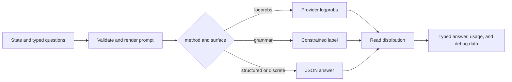

# jevper

**OpenAI's Decisions API answers from any OpenAI-compatible model.** `client.decisions.create(input=…, questions=[…])` takes the documented Decisions request and returns its documented response — `model`, `answers` in question order, and `usage` — evaluated by whatever model you point it at, over Chat Completions, Responses, or the Anthropic-compatible Messages API. That is what to reach for where `POST /v1/decisions` is not served yet: an endpoint without the route, a model the beta does not take (it serves `gpt-6-luna` alone), a local server, or a gateway in front of any of them. The models you already run answer the same questions here, in the same schema. See [Decisions API compatibility](decisions.md).

Underneath, jevper is a typed-question library: a state and `noul`, `choice`, or `score` questions in, typed answers out — `choice` and `score` answers carrying probabilities and confidence, a `noul` answer its `noul`. The Jev (System One) wire format is that library's own interface, and the whole of it is documented here; `client.system_one(...)` is the call the Decisions wrapper is built on.

jevper is an independent implementation of OpenAI's documented Decisions API schema and of the documented System One wire format. It is not affiliated with, endorsed by, or supported by OpenAI or TypeSafe AI. The package does not call the hosted TypeSafe API and does not import an OpenAI or Anthropic SDK at runtime.

## Install

Python 3.10 or newer is required. Install the package from PyPI:

```sh
pip install jevper
```

This site documents jevper 0.7.12. `python -c "import jevper; print(jevper.__version__)"` says
which release your environment has; a different number means the site is ahead of, or behind, what
you installed.

The only runtime dependency is `pydantic>=2.7`. You provide a client object; jevper does not read credentials or provider configuration from the environment.

## First call

```python
from openai import OpenAI
from jevper import SystemOneClient

client = SystemOneClient(OpenAI(), model="gpt-5.6-terra")

decision = client.decisions.create(
    input="I was charged twice for the same subscription this month.",
    questions=[
        {
            "type": "choice",
            "name": "intent",
            "instructions": "Pick the intent of the message.",
            "choices": [
                {"value": "billing", "description": "money, invoices, refunds, charges"},
                {"value": "technical", "description": "errors, crashes, login or performance problems"},
                {"value": "sales", "description": "pricing, plans, purchasing, upgrades"},
            ],
        }
    ],
)

answer = decision.answers[0]
print(answer.name, answer.choice, [entry.value for entry in answer.probabilities], answer.confidence)
```

`method="auto"` is the default: jevper uses logprobs when the provider returns a usable distribution and falls back to structured output when it does not. Whatever it chose, and what each provider call cost, is in `decision.raw.debug` and `decision.raw.usage` — the jevper response the wrapper converted, kept beside it and left out of every dump.

## The Jev interface underneath

The same call without the Decisions schema is `system_one`, which returns the answers keyed by your own question ids:

```python
from jevper import Choice, SystemOneClient

client = SystemOneClient(OpenAI(), model="gpt-5.6-terra")

response = client.system_one(
    state="I was charged twice for the same subscription this month.",
    questions={
        "intent": Choice(
            instructions="Pick the intent of the message.",
            criteria={
                "billing": "money, invoices, refunds, charges",
                "technical": "errors, crashes, login or performance problems",
                "sales": "pricing, plans, purchasing, upgrades",
            },
        )
    },
)

answer = response.answers["intent"]
print(answer.choice, answer.probabilities, answer.confidence)
```

Either response converts to the other shape: `response.to_decision()` returns the Decisions schema for a `system_one` response, with the names, values and labels the response itself remembers. See [API reference](api.md#decisions-api).

## Choose a page

| I want to… | Read |
| --- | --- |
| Use OpenAI's Decisions schema over a model that has no `/v1/decisions` | [Decisions API](decisions.md) |
| Install jevper and make the first sync or async call | [Getting started](getting-started.md) |
| See every public option set at once, with a program that runs | [Complete example](complete-example.md) |
| Understand how a call is built, and what each layer owns | [Architecture](architecture.md) |
| Choose `logprobs`, `grammar`, `structured`, or `discrete` | [Methods](methods.md) |
| Configure a local OpenAI-compatible server | [Local servers](local-servers.md) |
| Run decisions locally against [Ollaya](local-servers.md#ollaya-the-decision-server), including its native endpoint | [Local servers](local-servers.md#ollaya-the-decision-server) |
| Run decisions locally against [CLM](local-servers.md#clm-the-contrastive-decision-model), whose API is the same wire format | [Local servers](local-servers.md#clm-the-contrastive-decision-model) |
| Inspect the complete public API and error contract | [API reference](api.md) |
| Add native or two-step reasoning | [Reasoning](reasoning.md) |
| Provide demonstrations to the model | [Few-shot examples](few-shot.md) |
| Understand call flow, concurrency, retries, and tests | [Internals](internals.md) |
| Trace calls or host jevper with MLflow | [MLflow](mlflow.md) |
| Work out why a call failed and what to change | [Troubleshooting](troubleshooting.md) |
| Look up what a term in the docs means | [Glossary](glossary.md)

## How a call is selected



Start with [Getting started](getting-started.md) for the smallest working path, then use [Methods](methods.md) and [Local servers](local-servers.md) to tune the provider surface.
